<p align="center">
  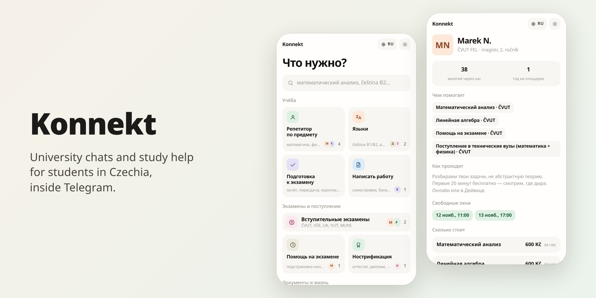
</p>

# Konnekt

Konnekt is a Telegram Mini App for students in Czechia. It started as a network
of university chats. The long-term plan is a platform for student life, and the
first piece of it is one narrow, in-demand niche: study help, meaning tutors,
exam prep and the paperwork of studying here. Students find a chat or a person,
see the price in Kč, and write to them in Telegram. A moderator bot keeps the
chats clean, and admins run everything from one console.

## In the Mini App

<table>
  <tr>
    <td align="center" width="33%">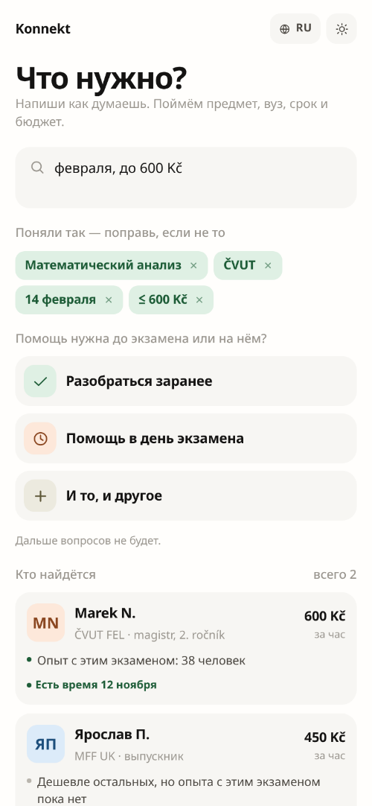<br><sub>Ask in your own words</sub></td>
    <td align="center" width="33%">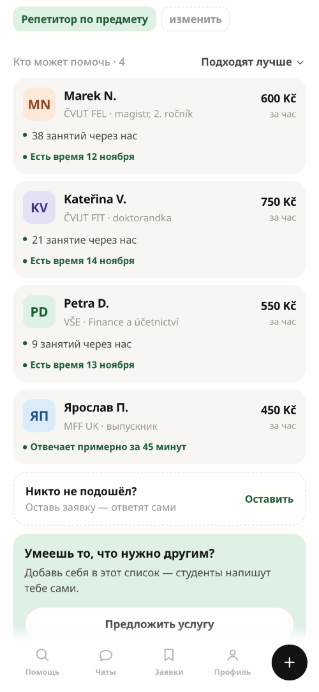<br><sub>Tutors with prices in Kč</sub></td>
    <td align="center" width="33%">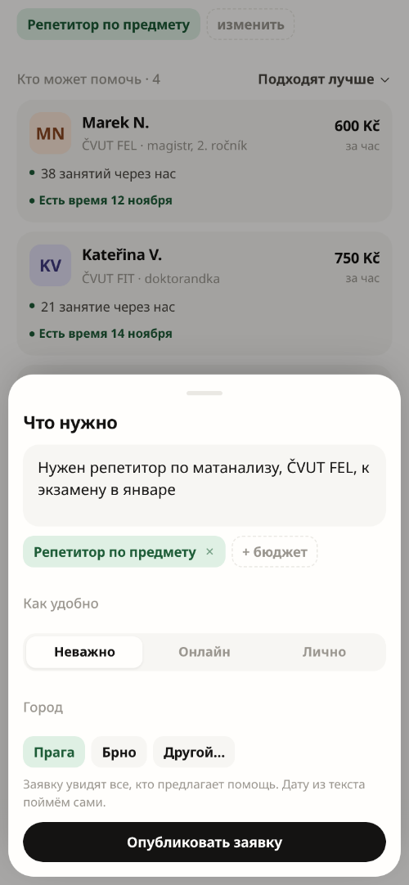<br><sub>Or leave a request</sub></td>
  </tr>
  <tr>
    <td align="center">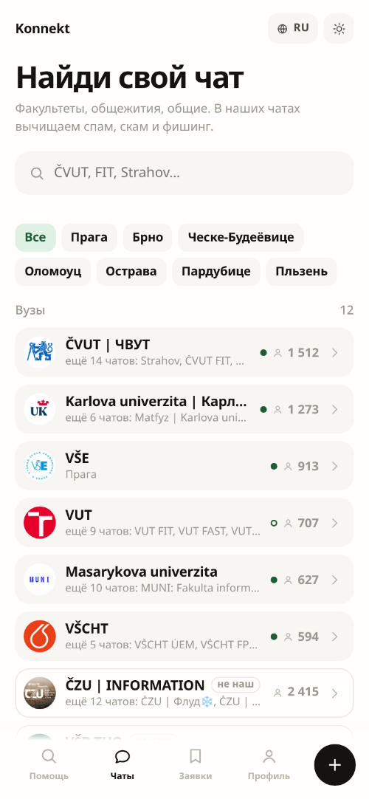<br><sub>Every university chat</sub></td>
    <td align="center">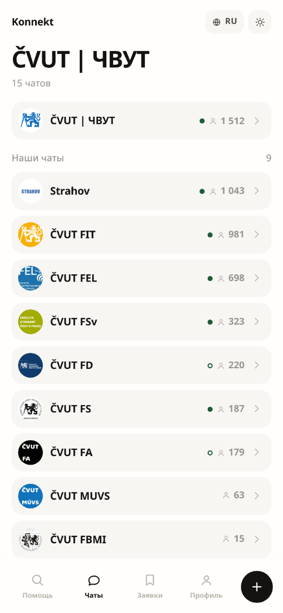<br><sub>A university, chat by chat</sub></td>
    <td align="center">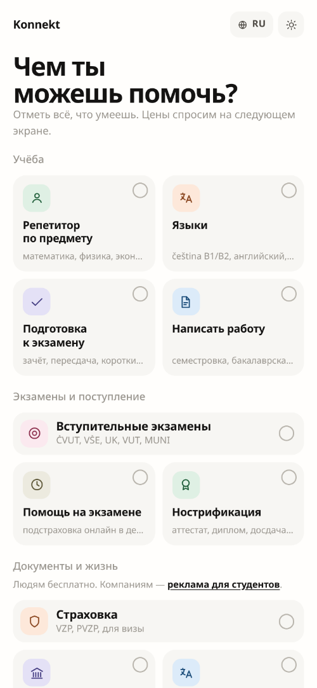<br><sub>Offer your own help</sub></td>
  </tr>
</table>

## In the console

<table>
  <tr>
    <td width="50%">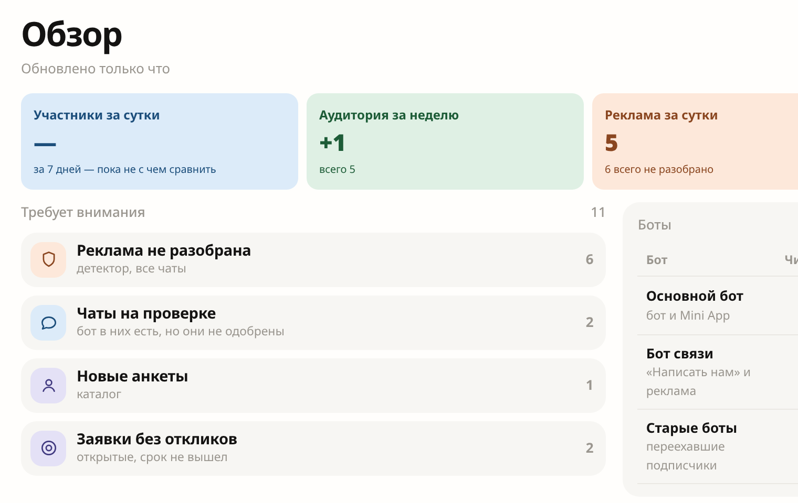<br><sub>Overview: what needs an admin today</sub></td>
    <td width="50%">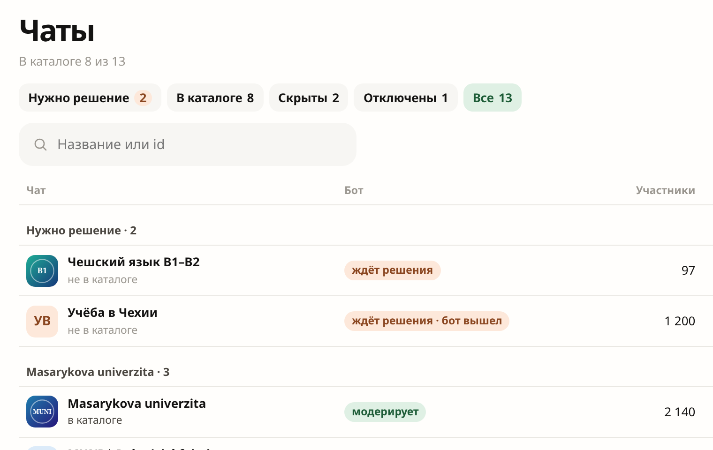<br><sub>Chats: which ones students can see</sub></td>
  </tr>
  <tr>
    <td>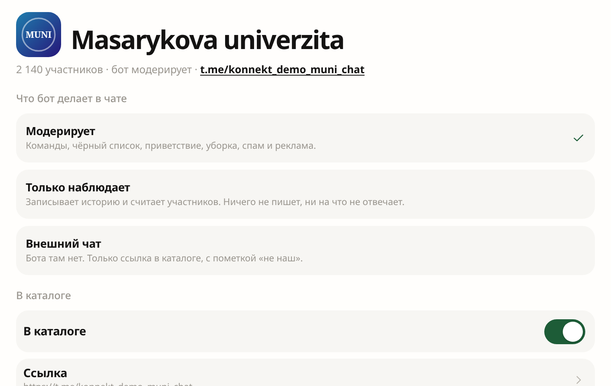<br><sub>A chat: captcha, welcome, catalog link</sub></td>
    <td>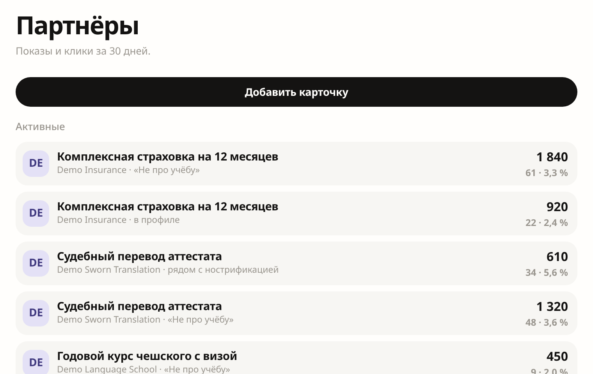<br><sub>Partners: their cards, views and clicks</sub></td>
  </tr>
</table>

## What is in this repository

| Part | What it does | Where |
| --- | --- | --- |
| Moderator bot | Join captcha, blacklist, ad detector, welcomes | `app/` |
| Web API | The chat directory and the console | `app/webapi/` |
| Catalog API | Tutors, services, requests; its own database | `catalog/` |
| Mini App and console | React 19, one app for students and admins | `web/` |

Removing a person always stays with a human: the control plane (an outside
agent) can only propose a ban or a blacklist entry, and a super admin confirms
it in the bot or the console, or it expires.

## Run it locally

You need Docker, uv and pnpm. Each of the last four lines is a long-running
process, so give each its own terminal.

```bash
cp .env.example .env            # MODERATOR_BOT_TOKEN, DB_*, ADMIN_SUPER_ADMINS
docker run -d --name konnekt-db -p 127.0.0.1:5432:5432 \
  -e POSTGRES_PASSWORD=<DB_PASSWORD from .env> -e POSTGRES_DB=moderator_bot \
  pgvector/pgvector:0.8.6-pg18-bookworm
uv sync --dev && uv run alembic upgrade head
uv run -m app.presentation.telegram                          # the bot
uv run uvicorn app.webapi.main:app --port 8787               # the web API
make -C catalog setup && make -C catalog api                 # the catalog API
pnpm --dir web install && pnpm --dir web dev                 # the Mini App
```

The Mini App's dev server serves HTTPS by default; see
[`web/README.md`](web/README.md) for that and for testing outside Telegram.

Production deploys from GitHub through the workflow; see
[`docs/deployment/`](docs/deployment/). How we work is in
[`AGENTS.md`](AGENTS.md), and the rules the code cannot state are in
[`docs/invariants.md`](docs/invariants.md).

MIT licensed.
